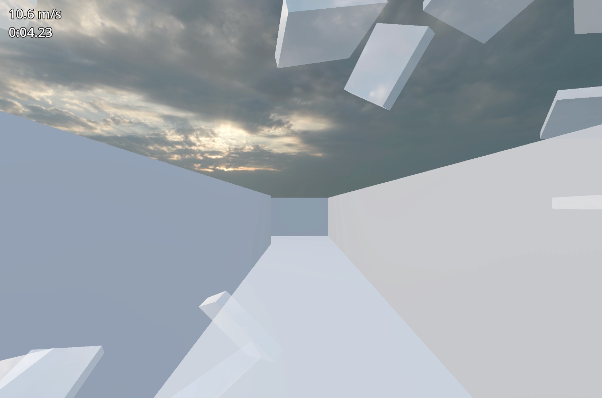

# Momentum

Momentum is a video game made in Godot combining the mechanics of puzzle solving with fun momentum-based movement. Sprint, slide, and launch yourself across multiple levels.

## About

This is a 3D game built in Godot. My goal is for it to be a game with fun momentum-based movement, mixed in with puzzle solving, exploring, and a story. I plan to work on this through the next few weeks to build it up into something great.

### Features

- Momentum-based movement: sprinting, sliding, jumping
- Classic puzzle elements: buttons, levers, pressure playes, drops, boxes (throwable!)
- Speed-based puzzle elements: boost pads, jump pads, speed gates, breakable glass
- Replayability: a run timer, best times, medals

### Levels

There are currently three levels. Level 1 introduces you to the basics, level 2 introduces some aerial mechanics, and the level 3 introduces breakable glass and speed gates.

## Why I made it

I love video games, and Terra was a great opporunity to work in Godot. I've worked on some projects before, but I've really finished or even got too far in the game. So far, this is the biggest game that I've worked on.

For the momentum, I was inspired by Vholume. This game is meant to be quite different as including puzzles, but the movement in that game is amazing.

For the puzzles, I was probably most inspired by the classic Portal 2. So far, some elements are similar, but I do have some unique ones already. My aim is to grow this into a full game with better movement, puzzle solving and maybe even a story!

## How to play

1. Go the the [Releases page](https://github.com/BingleyPro/momentum/releases), or click Releases on the right side of this page.
2. Under the latest release (at the top), download the file for your computer:

    - macOS: Momentum.dmg
    - Windows: Momentum.exe
3. Follow the steps for your computer below.

### macOS

1. Open the Momentum.dmg.
2. Drag the Momentum app into Applications or another folder.
3. Eject the .dmg from Finder, or by right-clicking it.
4. Open the Momentum app. If there is a message saying that it couldn't be verified, open System Settings, click Privacy & Security, scroll down until you see an option to Open Anyway. Then, launch it again.

### Windows

1. Run the Momentum.exe.
2. If a message saying "Windows protected your PC" or similiar, click More info and Run anyway.

## Controls

(also mentioned in-game):

- WASD to move
- E to interact
- Hold C to slide
- R to restart from last checkpoint
- T to fully restart
- Hold Shift to sprint
- Left click to throw box
- Escape to open pause menu

## Credits

Made by me with Godot!

See CREDITS.md for full credits.
